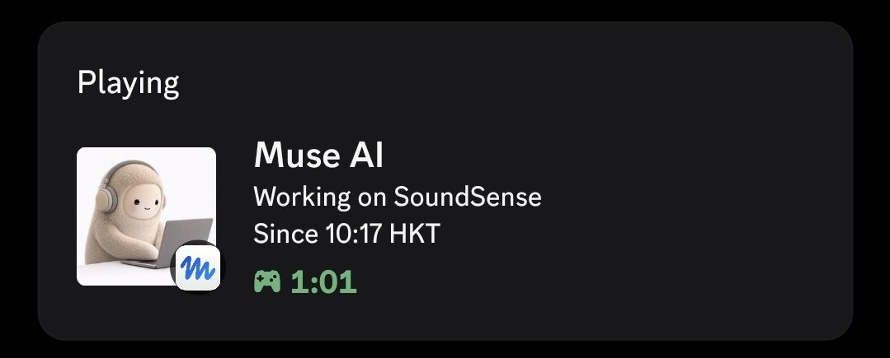

# Muse AI — Discord Rich Presence

Shows what Muse is doing, right on your Discord profile, while `Muse.app` is open on your Mac.

```text
Playing Muse AI
Working on SoundSense
Since 10:17 HKT
```



The big image is the animated Muse avatar for the current mode, with the blue Muse logo in the corner badge. No image uploads needed — everything is served from this repo.

## Modes

| Mode | Card text | Avatar |
|---|---|---|
| `working` | Working on `<project>` | at the laptop |
| `learning` | Learning: `<topic>` | making something |
| `done` | Finished: `<project>` | level up |
| `idle` | Chatting with Muse AI | waiting, then Idle → Sleeping |

Idle has three levels: **Ready** when the app is open and waiting, **Idle** after 5 minutes without input, **Sleeping** after 10.

## How it works

Muse has no Rich Presence of its own, and no API that reports what it is doing. This is a small Python helper that watches for `Muse.app`, connects to the Discord desktop app on the same Mac, and publishes the card.

Because the app exposes nothing, the status comes from `~/muse-discord-rpc/status.json`. You can write it yourself, let the assistant write it, or use the automatic tracker below.

## Install

**1. Create a Discord application** — [discord.com/developers/applications](https://discord.com/developers/applications) → *New Application* → copy the **Application ID** from General Information. No bot or token is needed.

The application name becomes the card's title line (`Muse AI`). It is read from Discord at startup, so renaming the application is enough — no code edit. The text inside the card uses the bot's own name instead; see [Names](#names).

**2. Get the files**

```bash
git clone https://github.com/kitzure/muse_discord_rpc.git ~/muse-discord-rpc
cd ~/muse-discord-rpc
pip3 install pypresence psutil
```

**3. Point it at your application**

```bash
export DISCORD_MUSE_CLIENT_ID="123456789012345678"
```

**4. Try it**

```bash
python3 muse_rpc.py            # Ctrl+C to stop
python3 set_status.py working "My project"
```

**5. Start it on login**

```bash
cp com.muse-discord-rpc.plist ~/Library/LaunchAgents/
# edit the plist: your user name and Application ID
launchctl load ~/Library/LaunchAgents/com.muse-discord-rpc.plist
```

## Automatic tracking (recommended)

`muse_activity.py` fills `status.json` from what the Mac is actually doing, so nobody has to write it by hand:

- **working** — code or project files changed in the last 30 seconds
- **learning** — notes, docs, PDFs or training material changed instead
- **done** — work stopped 0–45 seconds ago, keeps the project name
- **idle** — no keyboard/mouse for 90 seconds

It polls every 10 seconds, reads idle time from `ioreg`, and walks `~/Developer`, `~/Documents` and `~/Desktop` for the newest touched file, naming the **git/Xcode project** rather than the file's sub-folder.

Two rules keep it honest:

- **Muse-only** — if `Muse.app` is not running, the card reports idle, whatever else is happening on the machine.
- **Manual wins** — a `set_status.py` call overrides the tracker for 30 minutes.

```bash
python3 muse_activity.py       # run in the foreground to test
cp com.muse-activity.plist ~/Library/LaunchAgents/
# edit the plist: replace YOURNAME with your macOS user name
```

Logs: `~/muse-discord-rpc/activity.log`.

## Live activity line

Show what a task is doing under the project name:

```bash
python3 set_activity.py "Checking 42 listings..." 300   # 5 minutes
python3 set_activity.py clear                           # back to automatic
```

It also recognises long-running tools on its own — `Building...`, `Running tests...`, `Installing...`, `Processing video...`, `Compiling...`.

## Names

Two names appear on the card, and both are detected, never hard-coded:

| Where | Source |
|---|---|
| Title line (`Muse AI`) | the application's name in the Developer Portal |
| Card text (`Chatting with Muse AI`) | the name in Muse's own identity settings, then the bot user's `global_name`/`username`, then the application name |

The persona name comes from `~/Library/Preferences/com.meta.endo.plist` (`hatch_identity_cache`), re-read once a minute — rename yourself in Muse and the card follows, no edit and no restart.

To pin a name instead:

```bash
echo "Your Name" > ~/.muse-bot-name    # wins over detection
```

`~/.muse-app-name` caches the application name; delete either file to fall back to detection.

## Timezone label

The time reads `Since 10:17 HKT` — a short zone name when one exists, otherwise a readable name like `Hong Kong Standard Time`. A raw `UTC+0800` is never shown.

The zone comes from the system settings. To override it:

```bash
echo HKT > ~/.muse-timezone
```

## Remote work (optional)

If you run a coding agent on another machine and want the card to follow it, write `~/muse-discord-rpc/remote.json`:

```json
{"mode": "working", "task": "SoundSense", "state": "Editing files",
 "updated": 1795744927, "ttl": 90, "remote": true}
```

`remote: true` stops the local idle timer from clearing the card while that Mac sits untouched, and the entry expires on its own after `ttl` seconds.

## Known limits

- **No window titles.** macOS hides them without Accessibility permission, and `lsappinfo` returns no bundle name for some Electron apps, so activity comes from files and idle time.
- **Privacy protection hides folders.** Background agents cannot read `~/Documents` or `~/Desktop` until **Full Disk Access** is granted. The tracker logs `roots={...} denied={...}` each cycle; `Operation not permitted` means the folder is hidden. Grant it to the interpreter that actually runs the script — the Apple shim `/usr/bin/python3` does not pick up a grant, so point the plist at the real binary (e.g. `/opt/homebrew/bin/python3.11`).
- **Desktop Discord only.** Rich Presence does not work from the web client.

## Files

| File | Purpose |
|---|---|
| `muse_rpc.py` | connects to Discord and publishes the card |
| `set_status.py` | set mode + task by hand |
| `muse_activity.py` | automatic working/learning/done/idle |
| `set_activity.py` | live second line for a running task |
| `com.muse-discord-rpc.plist` | LaunchAgent for the RPC helper |
| `com.muse-activity.plist` | LaunchAgent for the activity tracker |
| `muse-logo.png`, `assets/` | hosted card images |

## Requirements

macOS with Python 3.9+, the Discord desktop app running on the same Mac, and a free Discord Application ID.

## License

MIT — see [`LICENSE`](LICENSE).
